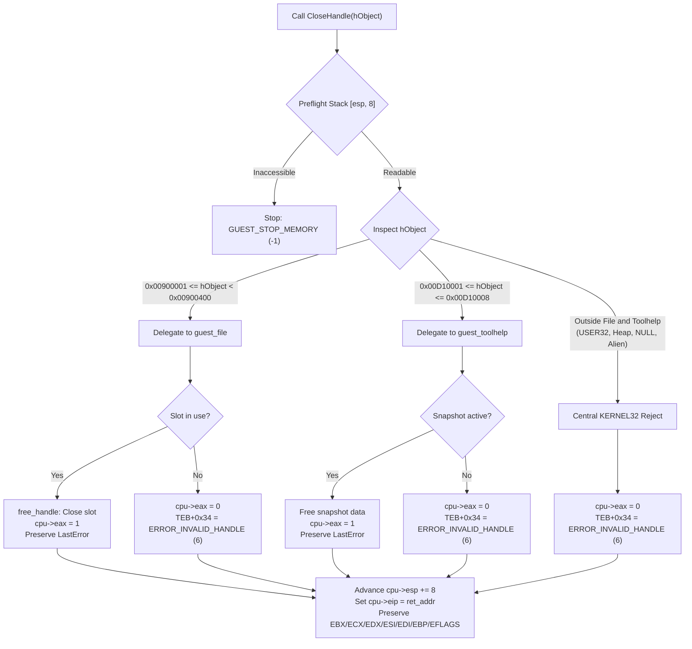

# Guest Handle Lifecycle Coordination & Subsystem Integration

## 1. Executive Summary & Context

In the NFSU2 iOS high-level emulation (HLE) runtime, multiple independent subsystems produce virtual guest handles representing diverse Win32 operating system resources:
- **File handles** (`runtime/guest_file.h`): File I/O descriptors backed by the virtual filesystem (VFS).
- **USER32 object handles** (`runtime/guest_user_objects.h`): Virtual cursors and icons loaded from PE image resources or shared system resources.
- **Heap handles** (`runtime/guest_heap.h`): Dynamic heap arenas allocated in the guest address space.
- **Toolhelp snapshot handles** (`runtime/guest_toolhelp.h`): Process, thread, and module snapshot enumerators produced by `CreateToolhelp32Snapshot`.

In Windows XP/Win32, these handle categories have fundamentally different lifecycles and disposal APIs:
1. File handles and Toolhelp snapshots are closed exclusively via `KERNEL32!CloseHandle`.
2. USER32 object handles (cursors/icons) are destroyed via `USER32!DestroyCursor` / `USER32!DestroyIcon` (or are persistent shared system objects). Passing a USER32 object handle to `CloseHandle` fails with `ERROR_INVALID_HANDLE` (6).
3. Heap handles are destroyed via `KERNEL32!HeapDestroy`. Passing a heap handle to `CloseHandle` fails with `ERROR_INVALID_HANDLE` (6).

This document specifies the exact architecture, memory boundaries, delegation logic, and integration changes required inside `GuestWindows` (`runtime/guest_windows.h` and `runtime/guest_windows.c`) to coordinate handle destruction safely, preserve Win32 LastError semantics, and prevent handle collisions or stale-handle use-after-free conditions.

---

## 2. Handle Partitioning & Memory Boundaries

To guarantee deterministic, non-colliding virtual identities across subsystems, handle numerical spaces are partitioned into segregated 32-bit integer domains separated by multi-megabyte guard intervals:

| Subsystem | Constant Base | Limit / Max Slots | Valid Handle Interval | Disposing API |
| :--- | :--- | :--- | :--- | :--- |
| **File Handles** | `GUEST_FILE_HANDLE_BASE = 0x00900000` | 1024 slots | `[0x00900001, 0x009003FF]` | `KERNEL32!CloseHandle` |
| *Guard Gap 1* | — | — | `[0x00900400, 0x00B10000)` (2,161,664 B) | — |
| **USER32 Objects** | `GUEST_USER_OBJECT_HANDLE_BASE = 0x00B10000` | 8 slots | `[0x00B10001, 0x00B10008]` | `USER32!DestroyCursor` / `Icon` |
| *Guard Gap 2* | — | — | `[0x00B10009, 0x00C00000)` (983,031 B) | — |
| **Guest TEB** | `GUEST_TEB_BASE = 0x00C00000` | 128 KB reservation | `[0x00C00000, 0x00C20000)` | Bootstrap owned |
| **Guest Process** | `GUEST_PROCESS_BASE = 0x00C20000` | 64 KB reservation | `[0x00C20000, 0x00C30000)` | Bootstrap owned |
| *Guard Gap 3* | — | — | `[0x00C30000, 0x00D10000)` (917,504 B) | — |
| **Toolhelp Snapshots** | `GUEST_TOOLHELP_HANDLE_BASE = 0x00D10000` | 8 slots | `[0x00D10001, 0x00D10008]` | `KERNEL32!CloseHandle` |
| *Guard Gap 4* | — | — | `[0x00D10009, 0x20000000)` (523,173,879 B) | — |
| **Guest Heaps** | `GUEST_HEAP_BASE = 0x20000000` | 4 arenas @ 64 MB | `[0x20000000, 0x30000000)` | `KERNEL32!HeapDestroy` |
| *Upper Memory / Sentinels* | `GUEST_INVALID_HANDLE_VALUE = 0xFFFFFFFF` | — | `0x00000000`, `0xFFFFFFFF` | Rejected |

### Non-Overlap Invariants
1. **Zero-Index Base Invalidation**: Base addresses (`0x00900000`, `0x00B10000`, `0x00D10000`) represent metadata roots, never valid handles. Valid handles are 1-based (`BASE + slot + 1`).
2. **Disjoint Sets**:
   $$\text{Domain}(\text{File}) \cap \text{Domain}(\text{UserObj}) \cap \text{Domain}(\text{Toolhelp}) \cap \text{Domain}(\text{Heap}) = \emptyset$$
3. **Guard Gaps**: Every partition boundary is cushioned by at least 896 KB of unallocated virtual space, preventing off-by-one or arithmetic overflows from masquerading as handles of adjacent subsystems.

---

## 3. Delegation Logic for `CloseHandle`

When `CloseHandle(HANDLE hObject)` is invoked:
1. **Calling Convention & Frame Validation**:
   - `stdcall`, 1 argument (`argc = 1`), 8-byte stack frame (`[esp] = return_ip`, `[esp + 4] = hObject`).
   - Frame must reside in accessible guest memory (`guest_memory_pointer(esp, 8, 0)`). If unmapped or crossing 4 GiB boundaries, execution stops with `GUEST_STOP_MEMORY` (-1) without modifying registers or state.
2. **Delegation Flow**:
   - **Case A: File Handle Domain** (`0x00900001 <= hObject < 0x00900400`):
     Delegated to `guest_file` subsystem (`handle_close_handle`).
     - If `hObject` is an open slot in `GuestFileTable`:
       Releases the slot, decreases active handle count, flushes/closes host fd if refcount reaches zero.
       Sets `cpu->eax = 1` (TRUE).
       **LastError is strictly preserved** (not cleared or modified).
     - If `hObject` is within range but not open (never allocated, or already closed):
       Sets `cpu->eax = 0` (FALSE).
       Sets `[cpu->fs_base + 0x34] = ERROR_INVALID_HANDLE` (6).
   - **Case B: Toolhelp Snapshot Domain** (`0x00D10001 <= hObject <= 0x00D10008`):
     Delegated to `guest_toolhelp` subsystem (`guest_toolhelp_close_handle`).
     - If `hObject` is an active snapshot in `GuestToolhelpSet`:
       Frees the snapshot structure and associated process/module list buffers.
       Sets `cpu->eax = 1` (TRUE).
       **LastError is strictly preserved**.
     - If `hObject` is within range but not active (never allocated, or already closed):
       Sets `cpu->eax = 0` (FALSE).
       Sets `[cpu->fs_base + 0x34] = ERROR_INVALID_HANDLE` (6).
   - **Case C: Alien or Non-Delegable Handles** (USER32 objects, Heaps, NULL, `0xFFFFFFFF`, base addresses, or arbitrary pointers):
     Caught by the central `KERNEL32` dispatcher (`guest_windows`):
     - Sets `cpu->eax = 0` (FALSE).
     - Sets `[cpu->fs_base + 0x34] = ERROR_INVALID_HANDLE` (6).
3. **Stack & Register Postconditions**:
   - `cpu->esp += 8` (pops arguments).
   - `cpu->eip = return_ip`.
   - General purpose registers (`EBX, ECX, EDX, ESI, EDI, EBP`) and `EFLAGS` are bit-for-bit preserved.



---

## 4. Win32 Error State & TEB Mechanics

### TEB Offset 0x34 Layout
On x86 Windows XP, each thread's Thread Environment Block (TEB) is accessible via segment register `FS`:
- `FS:[0x18]` = Linear address of the TEB self-pointer.
- `FS:[0x34]` = 32-bit unsigned LastError value (`DWORD`).

In the guest runtime:
- `cpu->fs_base` points to the thread's TEB base (default `0x00C00000`).
- Writing LastError computes `uint64_t teb_addr = (uint64_t)cpu->fs_base + 0x34ULL`.
- **Fault preflights**:
  - If `cpu->fs_base == 0`: returns `GUEST_STOP_API_STATE` (-2), `target = 0`.
  - If `teb_addr > 0xFFFFFFFF` or memory cannot be mapped as writable: returns `GUEST_STOP_MEMORY` (-1).

### Error Preservation Invariant
- **Success Contract**: Win32 API functions do NOT reset `LastError` to `ERROR_SUCCESS` (0) upon success. Any existing error code set by earlier operations is preserved across successful `CloseHandle` invocations.
- **Failure Contract**: Every failing `CloseHandle` invocation overwrites `FS:[0x34]` with `ERROR_INVALID_HANDLE` (6).
- **Idempotency**: Repeatedly calling `CloseHandle` on a previously closed handle fails identically and preserves the error state (`ERROR_INVALID_HANDLE`).

---

## 5. Integration Architecture inside `GuestWindows`

### 5.1 Modifications to `runtime/guest_windows.h`

```c
#ifndef NFSU2_GUEST_WINDOWS_H
#define NFSU2_GUEST_WINDOWS_H
#include "guest_execution.h"
#include "guest_heap.h"
#include "guest_critical.h"
#include "guest_tls.h"
#include "guest_process.h"
#include "guest_locale.h"
#include "guest_user_objects.h"
#include "guest_toolhelp.h"      /* Toolhelp snapshot subsystem */
#include "guest_file.h"          /* File handle subsystem */

typedef struct GuestWindows {
    uint32_t image_base;
    GuestPEImage resource_image;
    GuestUserObjects user_objects;
    GuestHeapSet heaps;
    GuestCriticalSet critical;
    GuestTLSSet tls;
    GuestProcess process;
    uint32_t unhandled_exception_filter;
    GuestToolhelpSet toolhelp;   /* Toolhelp snapshots table (max 8) */
    GuestFileTable *files;       /* Pointer to active file table */
} GuestWindows;
```

### 5.2 Modifications to `runtime/guest_windows.c`

#### Dispatch Integration in `guest_windows_import`:
```c
/* Helper for setting TEB LastError on failure */
static int set_teb_last_error(CPU *c, uint32_t error_code, uint32_t *fault) {
    if (!c->fs_base) { *fault = 0; return -2; }
    uint64_t error_addr = (uint64_t)c->fs_base + 0x34u;
    if (error_addr > UINT32_MAX) { *fault = UINT32_MAX; return -1; }
    void *error = guest_memory_pointer((uint32_t)error_addr, 4, 1);
    if (!error) { *fault = (uint32_t)error_addr; return -1; }
    write32(error, error_code);
    return 0;
}

/* CloseHandle unified lifecycle dispatcher */
static int handle_close_handle(CPU *c, const GuestImport *import,
                               GuestWindows *windows, uint32_t *fault) {
    if (strcmp(import->name, "CloseHandle")) return 0;

    const uint8_t *frame = guest_memory_pointer(c->esp, 8, 0);
    if (!frame) { *fault = c->esp; return -1; }
    uint32_t return_ip = read32(frame);
    uint32_t h_object = read32(frame + 4);

    /* 1. Delegate to File Subsystem if within file handle partition */
    if (h_object >= GUEST_FILE_HANDLE_BASE + 1 &&
        h_object < GUEST_FILE_HANDLE_BASE + GUEST_FILE_HANDLE_MAX) {
        if (windows && windows->files) {
            return guest_file_import(c, import, windows->files, fault);
        }
    }

    /* 2. Delegate to Toolhelp Subsystem if within snapshot partition */
    if (h_object >= GUEST_TOOLHELP_HANDLE_BASE + 1 &&
        h_object <= GUEST_TOOLHELP_HANDLE_BASE + GUEST_TOOLHELP_HANDLE_MAX) {
        if (windows) {
            return guest_toolhelp_import(c, import, &windows->toolhelp, fault);
        }
    }

    /* 3. Non-delegable / alien / invalid handles */
    int rc = set_teb_last_error(c, 6u /* ERROR_INVALID_HANDLE */, fault);
    if (rc) return rc;

    c->eax = 0u;
    c->eip = return_ip;
    c->esp += 8u;
    return 1;
}
```

#### Cleanup Integration in `guest_windows_cleanup`:
```c
int guest_windows_cleanup(GuestWindows *windows) {
    if (!windows) return EINVAL;
    windows->unhandled_exception_filter = 0;
    guest_user_objects_cleanup(&windows->user_objects);
    guest_toolhelp_cleanup(&windows->toolhelp); /* Free active snapshots */
    guest_process_cleanup(&windows->process);
    int rc = guest_critical_cleanup(&windows->critical);
    if (!rc) guest_tls_cleanup(&windows->tls);
    return rc;
}
```

---

## 6. Comprehensive Integration Test Suite

The test suite in `tools/ios_private/test_handle_lifecycle.py` covers 31 regression cases verifying:
1. **Handle Partition Non-Overlap**:
   - Verification of `runtime/guest_file.h`, `runtime/guest_user_objects.h`, and `runtime/guest_heap.h` constants against test fixtures.
   - Pairwise disjointness proofs across all four handle domains.
   - Verification of positive multi-megabyte guard intervals.
   - Verification that 0-indexed base values are invalid.
2. **File Handle Delegation**:
   - Single and boundary slot allocation and successful close (`EAX = 1`, LastError preserved, slot freed).
   - Double close failure (`EAX = 0`, LastError set to 6).
   - Unallocated handle in valid range failure.
   - Interleaved close of multiple active handles.
3. **Toolhelp Snapshot Delegation**:
   - Single and boundary slot allocation and successful close (`EAX = 1`, LastError preserved, snapshot freed).
   - Double close failure (`EAX = 0`, LastError set to 6).
   - Unallocated snapshot in valid range failure.
   - Interleaved close of multiple active snapshots.
4. **Alien and Non-Delegable Handles**:
   - USER32 cursor and icon rejection (`EAX = 0`, LastError set to 6, object table unaffected).
   - Heap handle rejection (`EAX = 0`, LastError set to 6, heaps unaffected).
   - Special sentinels (`0` NULL, `0xFFFFFFFF` INVALID_HANDLE_VALUE) rejection.
   - Boundary edge cases (`BASE`, `BASE + MAX`, random pointers).
5. **TEB LastError Offset 0x34 & Memory Fault Semantics**:
   - Success preserves arbitrary pre-existing error sentinels (`0, 1, 2, 5, 80, 183, 0x12345678`).
   - Failure writes 6 (`ERROR_INVALID_HANDLE`).
   - Idempotent transitions across consecutive calls.
   - Memory fault on unmapped/wrapping stack.
   - API state fault on null TEB.
   - Memory fault on unmapped/overflowing TEB LastError offset.
6. **Register Preservation**:
   - `EBX, ECX, EDX, ESI, EDI, EBP`, and `EFLAGS` bit-for-bit preserved across success and failure.
