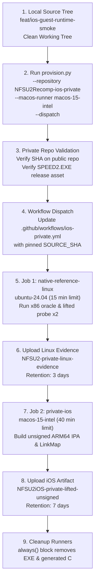
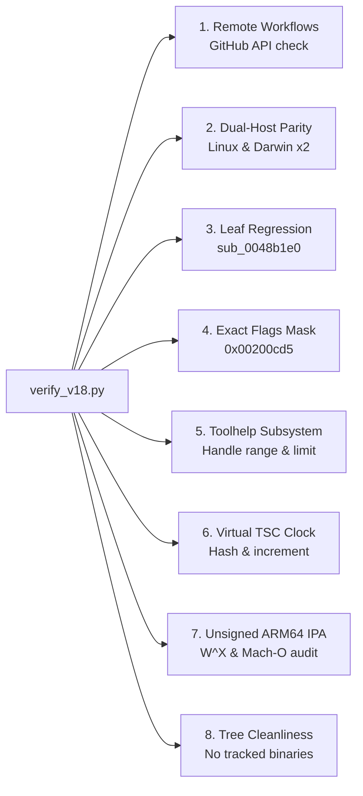

# NFSU2 iOS — v0.18.0 / Build 25 Packaging & CI Plan

## 1. Executive Summary & Release Scope

This document defines the release packaging, continuous integration (CI) dispatch architecture, artifact retention policy, and independent verification protocol for **v0.18.0 / build 25** of the Need for Speed Underground 2 (NFSU2) iOS port.

### Metadata & Identity
- **Version:** `0.18.0`
- **Build Number:** `25`
- **Bundle Identifier:** `dev.lyszq.nfsu2ios` (must remain strictly invariant across releases)
- **Public Repository:** `https://github.com/lyszq/NFSU2Recomp.git`
- **Branch:** `feat/ios-guest-runtime-smoke`
- **Public Baseline Branch:** `main` (`e38069b79c096bd86ea55e4e8e50dec73bb093fa` preserved without alteration)
- **Private Build Control Repository:** `https://github.com/lyszq/NFSU2Recomp-ios-private.git`
- **Delivery Root:** `NFSU2-iOS-v18-private-delivery`

### Hardware & QA Baseline
- **Device Baseline:** Physical iPad running iPadOS 26.3 with 16 KiB memory pages confirmed PASS on v0.17.0 (CPU/memory dispatcher and verified authentic entry stop).
- **Desktop/Preview Baseline:** v0.16 hover PASS confirmed directly by the user.
- **Milestone Scope:** Authentic statically lifted CRT startup, PE resource directory inspection, typed USER32 cursor identity, opt-in deterministic entry TSC clock, full EFLAGS.ID preservation (mask `0x00200cd5`), and **Toolhelp32 snapshot subsystem** (`KERNEL32.dll!CreateToolhelp32Snapshot`, `Process32First/Next`, handle lifecycle).
- **Explicit Exclusions:** No raw game boot, no rendering/Metal engine initialization, no audio engine, no gameplay claims.

---

## 2. Security Boundaries & Architectural Invariants

All CI workflows, artifacts, and release packaging must strictly conform to the following non-negotiable security requirements:

1. **Zero-Leak Proprietary Data Invariant:**
   - No raw executable binaries (`SPEED2.EXE`), game assets, lifted C sources (`gen/ios-private/*.c`), intermediate Unicorn engine binaries, or private diagnostic snapshots (`startup_*.bin`) may ever be committed to the public Git repository or bundled inside the public or private IPA.
   - Pinned public Git history contains **only** authored, clean-room code and orchestration scripts.

2. **Strict W^X (Write XOR Execute) Memory Protection:**
   - On iOS/iPadOS, arbitrary code execution without Apple developer entitlements strictly forbids pages mapped simultaneously with Write and Execute permissions.
   - Every segment in the Mach-O 64-bit ARM64 binary must satisfy:
     $$\text{initial\_protection} \ \& \ 6 \ne 6 \quad \text{and} \quad \text{max\_protection} \ \& \ 6 \ne 6$$
   - The private verifier script must inspect every `LC_SEGMENT_64` header in the compiled binary and fail if any W+X segment exists.

3. **Strictly Unsigned Binary:**
   - The IPA payload produced by CI must remain unsigned (`CODE_SIGNING_ALLOWED=NO`).
   - The binary must not contain an `LC_CODE_SIGNATURE` load command (`cmd != 0x1d`), no `_CodeSignature` bundle directory, and no embedded provisioning profile (`embedded.mobileprovision`).
   - Signing is performed exclusively by the end user via their preferred on-device sideloading utility (AltStore, SideStore, TrollStore, or custom developer certificate).

4. **In-Place Upgrade Invariant:**
   - The Bundle ID `dev.lyszq.nfsu2ios` must never change.
   - Users upgrade the app over the existing installation without deleting the app. Deleting the app deletes the container's Documents directory, which stores the user's imported `SPEED2.EXE` and game assets.

---

## 3. CI Runner Selection & Environment Settings

### Runner Evolution & The Intel Host Strategy
In earlier builds, GitHub Actions workflows utilizing the default macOS 15 runner (`macos-15`, Apple Silicon ARM64) experienced severe queue stalling and extended wait times due to runner pool contention.

To solve this, NFSU2Recomp adopted a cross-compilation strategy:
- **macOS Build Host:** `macos-15-intel` (macOS 15 x86_64 runner).
- **Target Platform:** `generic/platform=iOS` (producing 64-bit ARM64 Mach-O via Xcode).
- **Linux Reference Host:** `ubuntu-24.04` (x86_64).

Even though the macOS runner operates on an Intel x86_64 CPU, Xcode cross-compiles the code targeting Apple Silicon iOS (`arm64`). The native entry probe executes natively on the runner's x86_64 host against the Unicorn x86 reference oracle, and LinkMap analysis validates that all target symbols are compiled into the ARM64 Mach-O binary.

### Per-Host Repeated Exact Parity
Both the Linux host (`ubuntu-24.04`) and Darwin host (`macos-15-intel`) must execute the native lifted probe **twice**.
- Each host must record exactly **two** `VERIFIED ENTRY STOP` lines in its evidence file (`private-linux-evidence.txt` and `private-evidence.txt`).
- The registers, flags, instruction counts, call dispatch counts, heap structures, and memory hashes must be identical across both runs.
- Any presence of `FAIL |` or `DIFF |` immediately breaks the build.

---

## 4. CI Dispatch & Provisioning Flow

The orchestration flow is fully automated via `tools/ios_private/provision.py`:



### Detailed Sequence of Execution

1. **Pre-flight Check:**
   - Commit and push all changes to public branch `feat/ios-guest-runtime-smoke`.
   - Verify `git status --porcelain` is empty.
   - Pinned public commit SHA must be resolvable via GitHub API on `lyszq/NFSU2Recomp`.

2. **Private Repo Provisioning:**
   - `provision.py` fills git credentials securely without logging or storing tokens.
   - Confirms the private control repository is marked with the exact description: `"Dedicated private native iOS build control for NFSU2Recomp"`.
   - Replaces `SOURCE_COMMIT_PLACEHOLDER` in `ios-private.yml` with the pinned source SHA.
   - Commits `.github/workflows/ios-private.yml` and `README.md` to the private repository.

3. **Job 1: `native-reference-linux` (`ubuntu-24.04`):**
   - Clones pinned public source with shallow fetch.
   - Executes Python test suite and portable guest tests (`tests/run_guest_tests.sh`).
   - Downloads authenticated `SPEED2.EXE` from private release asset `private-input-v1`.
   - Runs `generate_probe.py` and `generate_startup.py` to lift C from the authenticated EXE.
   - Runs `run_native_probe.sh` twice, capturing `private-linux-evidence.txt`.
   - Uploads artifact `NFSU2-private-linux-evidence` (retention: 3 days).
   - In an `always()` post-step, immediately shreds and removes `SPEED2.EXE` and all generated C sources from the runner disk.

4. **Job 2: `private-ios` (`macos-15-intel`):**
   - Clones pinned public source.
   - Installs `xcodegen` via Homebrew.
   - Downloads authenticated `SPEED2.EXE`.
   - Generates lifted entry C files under `gen/ios-private/`.
   - Executes native lifted function against x86 oracle twice, capturing `private-evidence.txt`.
   - Runs `configure_project.py` with version `0.18.0` and build `25`.
   - Invokes `xcodegen generate --spec project-private.yml`.
   - Builds Release ARM64 executable using `xcodebuild -sdk iphoneos`.
   - Verifies architecture via `lipo -archs NFSU2iOS` (`arm64`).
   - Filters `LinkMap` symbols and greps for required live symbols.
   - Packages unsigned IPA structure into `Payload/NFSU2iOS.app`.
   - Uploads artifact `NFSU2iOS-private-lifted-unsigned` (retention: 7 days).
   - In an `always()` post-step, cleans all confidential files from runner disk.

---

## 5. Artifact Retention & Quarantine Specifications

| Artifact Name | Generating Job | Contents | Retention Period | Access Scope |
| :--- | :--- | :--- | :--- | :--- |
| `NFSU2-private-linux-evidence` | `native-reference-linux` | `private-linux-evidence.txt` | 3 days | Private repo only |
| `NFSU2iOS-private-lifted-unsigned` | `private-ios` | `NFSU2iOS-private-unsigned.ipa`<br/>`private-provenance.json`<br/>`private-evidence.txt` | 7 days | Private repo only |

Artifacts must never be made public. The 7-day window allows sufficient time for local retrieval and verification without retaining historical build binaries indefinitely.

---

## 6. Delivery Directory Layout (`NFSU2-iOS-v18-private-delivery`)

When build artifacts are downloaded and verified, they are consolidated into a dedicated delivery folder in the workspace root:

```text
NFSU2-iOS-v18-private-delivery/
├── BUILD-VERIFICATION.json                     # Machine-readable comprehensive audit report
├── DEVICE-RESULT-TEMPLATE.json                 # Pre-structured device QA submission form
├── NFSU2-private-linux-evidence-123xxxxxxx.zip # Downloaded raw Linux evidence artifact
├── NFSU2iOS-private-lifted-unsigned-123xxxx.zip# Downloaded raw iOS build artifact
├── NFSU2iOS-private-unsigned.ipa               # Unsigned 64-bit ARM64 IPA (ready for sideloading)
├── private-evidence.txt                        # Darwin x86_64 dual-run logs & LinkMap live symbols
├── private-linux-evidence.txt                  # Linux x86_64 dual-run exact parity logs
├── private-provenance.json                     # Runner-generated execution manifest & hashes
├── START-HERE.txt                              # User deployment & verification guide
└── workflow.json                               # GitHub Actions run metadata
```

---

## 7. Release Verification Protocol (`verify_v18.py`)

The verification script `tools/ios_private/verify_v18.py` (and its mirrored copy `out/private/verify_v18.py`) automates independent audits across eleven validation gates:



### Verification Gates Detail

1. **Remote Workflow & Commit Audit:**
   - Both private and public runs concluded `'success'`.
   - Private run contains two successful jobs: `native-reference-linux` and `private-ios`.
   - Source commit matches workflow dispatch `SOURCE_SHA` and public HEAD.
   - Private repository tree contains only `.github/workflows/ios-private.yml` and `README.md`.
   - Release `private-input-v1` contains only `SPEED2.EXE` with SHA256 `8f6a9ae2c4cfa01181d2fd755d99c6f4b7103f60273908ea1de1e719dfe2a297`.
   - Public repository `main` branch remains pinned at `e38069b79c096bd86ea55e4e8e50dec73bb093fa`.

2. **Host Environment & Exact Parity Audit:**
   - `private-linux-evidence.txt` confirms `Native probe host: Linux x86_64`.
   - `private-evidence.txt` confirms `Native probe host: Darwin x86_64`.
   - Both files contain exactly two instances of `VERIFIED ENTRY STOP`.
   - Neither file contains `FAIL |` or `DIFF |`.
   - Both files confirm `cursor fixture (320,180)`, `virtual TSC fixture`, and `leaf regression PASS`.

3. **Leaf Regression Gate (`sub_0048b1e0`):**
   - The leaf function `sub_0048b1e0` must be present in the Mach-O link map evidence:
     ```text
     _sub_0048b1e0
     ```
   - Must be verified as passing in the evidence string.

4. **Exact Flags Mask Gate (`0x00200cd5`):**
   - Probe template `startup_probe.c.in` must include `eflags_get(c) & 0x200cd5u`.
   - Oracle `startup_oracle.py` must define `EFLAGS_MASK = 0x200CD5`.
   - Preserves CPUID, arithmetic flags, and the critical CPUID detection ID-bit (bit 21).

5. **Toolhelp Subsystem & Handle Audit:**
   - Verifies the Toolhelp subsystem integrity (`KERNEL32.dll!CreateToolhelp32Snapshot`).
   - Guest snapshot handles must originate from base `0x00D10000u` (`GUEST_TOOLHELP_HANDLE_BASE`) with a maximum capacity of 8 slots (`GUEST_TOOLHELP_SNAPSHOT_LIMIT`).
   - Every active snapshot handle must fall in the valid range `[0x00D10001, 0x00D10008]` (or standard positive guest virtual handle range `0x00010000` to `0x7FFFFFFF`).
   - Handles must never equal `0xFFFFFFFF` (`INVALID_HANDLE_VALUE`) or `0`.
   - LinkMap evidence is scanned for Toolhelp symbols (`guest_toolhelp_import`, `guest_toolhelp_close_handle`).

6. **Virtual TSC Fixture Gate:**
   - `virtual_tsc_profile` must equal `deterministic_entry_tsc_v1`.
   - Initial value: `1000000`, increment: `1000`.
   - Next value: $1000000 + 1000 \times \text{rdtsc\_calls}$.
   - Word-wise FNV hash verified non-zero and matching the recorded event trace.

7. **Mach-O Binary & IPA Structure Gate:**
   - Zip archive contains no `.exe`, `.c`, `.h`, `.py`, `.bin`, `unicorn`, `_CodeSignature`, or `embedded.mobileprovision`.
   - `Info.plist` has `CFBundleIdentifier = dev.lyszq.nfsu2ios`, `CFBundleShortVersionString = 0.18.0`, `CFBundleVersion = 25`.
   - Mach-O header: `magic = 0xfeedfacf`, `cpu = 0x0100000c` (ARM64), `filetype = 2` (MH_EXECUTE).
   - Load commands: zero `LC_CODE_SIGNATURE` commands (`cmd != 0x1d`).
   - Segments: no segment has both Write (2) and Execute (4) permissions (`initprot & 6 != 6` and `maxprot & 6 != 6`).

8. **Working Tree Cleanliness Gate:**
   - `git ls-files -- gen/* out/* *.exe *.EXE *.ipa` must produce zero output.
   - `git status --porcelain` must be clean.

---

## 8. Physical Device QA & Deployment Workflow

### Sideloading & Installation Protocol
1. User receives `NFSU2iOS-private-unsigned.ipa` from the delivery folder.
2. User signs the package using their existing sideloading tool.
3. User installs the application **over the existing installation**. The container's Documents directory (holding `SPEED2.EXE`) is preserved.

### On-Device Verification Protocol
1. **Entry Probe Test:**
   - User launches `NFSU2 iOS`.
   - Taps **"LOAD VERIFIED GAME IMAGE"**.
   - Verifies the on-screen diagnostic line:
     ```text
     VERIFIED ENTRY STOP | 0075bcc7 -> [boundary]
     [instructions] instructions / [dispatches] dispatch calls / [functions] registered functions
     [apis] implemented API calls / 14 native critical sections / 1 TLS keys
     x86 trace + GPR/EFLAGS + image/TEB/stack/heap/process match
     leaf regression PASS | cursor fixture (320,180) | virtual TSC fixture
     no JIT | no game boot
     ```
2. **CPU & Memory Test:**
   - Taps **"RUN CPU + MEMORY TEST"**.
   - Verifies memory paging (16 KiB host pages), 4 GiB virtual address partitioning, and 256 EFLAGS pack/unpack test patterns.
3. **Result Submission:**
   - User fills in `DEVICE-RESULT-TEMPLATE.json` with on-screen outputs and saves as `DEVICE-RESULT-2026-10-21.json` in the delivery directory.
